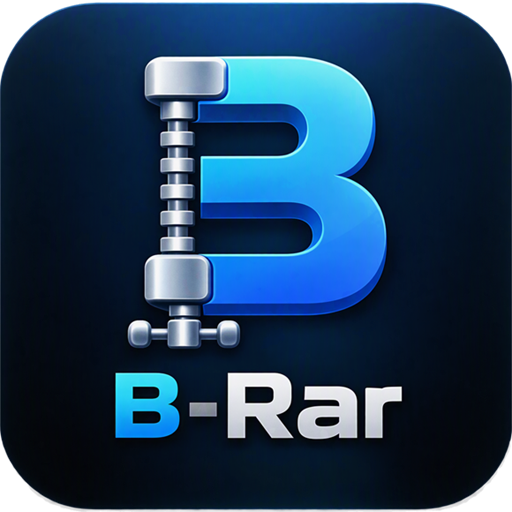

<p align="center"></p>

# B-Rar

[](https://www.patreon.com/cw/ahmedanjum30)

**A fast archive extractor for Windows.** B-Rar opens ZIP, RAR, 7z and tar archives and extracts them faster than WinRAR, 7-Zip and Windows' own tar, using every core of your PC. It sits in the Windows 11 right-click menu, like WinRAR.

[](https://github.com/ahmedanjum30/B-Rar/actions/workflows/ci.yml)
[](LICENSE)

Free for personal and other non-commercial use. See [License](#license).

**[Download the latest version](https://github.com/ahmedanjum30/B-Rar/releases/latest)** for Windows 10 and 11, or visit the [website](https://ahmedanjum30.github.io/B-Rar/). Microsoft Store: coming soon.

## Features

- **Fast.** Archives are extracted in parallel, file by file, on all cores. B-Rar has its own RAR5 decoder (faster than 7-Zip's on one core) and its own Deflate decoder for ZIP, which also splits one big file across all cores (3.5–4.4x libdeflate on one core).
- **Right-click menu.** Right-click an archive: **Open in B-Rar**, **Extract files...**, **Extract to "name\\"**, **Extract here** or **Test archive**. On Windows 11 it's under **Show more options**; the Microsoft Store version (coming soon) puts it in the short menu.
- **Look inside first.** Open an archive to browse its folders, search it, open single files, and extract only the files and folders you pick.
- **Formats:** ZIP (Deflate, Deflate64, BZip2, LZMA, XZ, Zstandard, PPMd, AES and ZipCrypto), RAR 4 and 5, 7z, tar and tar.gz, tar.xz, tar.zst, tar.bz2, and single .gz, .xz, .zst and .bz2 files.
- **Archives in parts:** RAR volumes (`name.part1.rar`, `name.r00`) and split files (`name.7z.001`, `name.zip.001`). Start from any part; a missing part is named.
- **Passwords:** asks when an archive is encrypted, including archives with encrypted file names.
- **Safe by default:** asks before replacing a file (replace, skip, keep both, for all), refuses paths that would escape the destination folder, and checks every file's checksum.
- **Protected folders:** extracting into Program Files or another folder that needs administrator rights shows the Windows permission prompt.
- **Command line:** `B-Rar x archive.rar` from any terminal.

B-Rar reads archives; it doesn't create them.

## Speed

Every tool with its default settings, on the same PC (Ryzen 7 5800H, 16 threads, NVMe SSD), extracting to the same drive. Lower is better. Full method and history: [benches/RESULTS.md](benches/RESULTS.md).

| Archive | B-Rar | WinRAR | 7-Zip | Windows tar |
|---|---|---|---|---|
| ZIP, 1.25 GB | **0.9 s** | 6.3 s | 5.8 s | 3.2 s |
| RAR5, 1.1 GB | **0.8 s** | 4.0 s | 7.6 s | 15.1 s |
| RAR5, 48,000 small files | **6.6 s** | 29.2 s | 24.0 s | 26.3 s ¹ |
| ZIP, 47,000 small files | **6.5 s** | 22.8 s | 25.7 s | 16.2 s ¹ |
| tar.gz, 47,000 small files | **6.1 s** | 24.2 s | n/a | 17.1 s |
| 7z (LZMA2), 1.0 GB | 7.0 s | 5.1 s | **5.0 s** | 44.4 s |

¹ Windows tar stopped at a file with a non-ASCII name and skipped it.

7z is the one format where 7-Zip is still faster; a faster LZMA decoder is planned.

## Installing

**Installer:** `B-Rar-Setup-<version>.exe` from [Releases](https://github.com/ahmedanjum30/B-Rar/releases/latest) (or the [website](https://ahmedanjum30.github.io/B-Rar/)). It installs for your user without admin rights, adds B-Rar to the right-click menu of archives (on Windows 11 under **Show more options**) and to **Open with**, and can add `B-Rar` to PATH. After that, B-Rar says when a new version is out and updates itself when you click **Update**.

### "Windows protected your PC"

Windows SmartScreen shows this for programs that aren't code-signed and that Microsoft hasn't seen many people download yet. B-Rar isn't code-signed yet, so Windows can't name the publisher and says "Unknown publisher". To install it anyway:

1. Click **More info**.
2. Click **Run anyway**.

The installer on the Releases page is built by this repository's [release workflow](.github/workflows/release.yml) from the source you see here. To check that your download is that file, compare its SHA-256 (`Get-FileHash B-Rar-Setup-<version>.exe` in PowerShell) with `SHA256SUMS.txt` on the same release.

### Other ways to get it

**Microsoft Store:** coming soon. It's the full app with the Windows 11 short right-click menu, and it updates itself. Once it's in the Store, `winget install B-Rar` installs it too.

**Portable:** `B-Rar-<version>-portable-x64.zip` from [Releases](https://github.com/ahmedanjum30/B-Rar/releases/latest) has `B-Rar.exe` (command line) and `B-Rar-GUI.exe` (the window) with nothing to install, and no right-click menu. Run `B-Rar-GUI.exe archive.zip` to browse an archive. The zip is built by this repository's [release workflow](.github/workflows/release.yml) from the source you see here; to check yours, compare its SHA-256 (`Get-FileHash <file>` in PowerShell) with `SHA256SUMS.txt` on the same release.

**Updates:** the Store version updates itself. The installed and portable versions (and the `-x64.msix` signed with B-Rar's own certificate) check GitHub when the window opens and say when a new version is out; nothing is downloaded until you click **Update**. The download is checked against the release's `SHA256SUMS.txt`, then the new setup runs (B-Rar reopens afterwards), the portable files are replaced in place, or the package opens in App Installer.

Questions or ideas? Found a bug? Open an [issue](https://github.com/ahmedanjum30/B-Rar/issues).

## Command line

```text
B-Rar x archive.rar                      extract to a folder named after the archive
B-Rar x archive.rar -o D:\out            extract to D:\out
B-Rar x archive.rar --here               extract next to the archive
B-Rar x archive.zip docs photos/2024     extract only these files and folders
B-Rar x archive.zip docs/a.txt --from docs   ...written relative to docs
B-Rar l archive.7z                       list the contents
B-Rar t archive.7z                       test: decode everything, write nothing
```

Options: `-y` overwrite without asking, `--skip-existing`, `--rename-existing`, `-p <password>`, `-t <threads>`. `B-Rar --help` lists them all.

## Building from source

You need [Rust](https://rustup.rs/) 1.99 or newer with the `x86_64-pc-windows-gnu` toolchain, and a MinGW-w64 GCC (for example [WinLibs](https://winlibs.com) or MSYS2's UCRT64 `gcc`) on `PATH`: the bundled unRAR sources are C++.

```sh
cargo build --release
```

The programs are in `target/release`. `installer\build.ps1` packages them as an MSIX signed with a local certificate from `installer\new-cert.ps1` (`-Quick` for a fast test build, `-Install` to install it); `-Store` builds the unsigned package for the Microsoft Store.

## Project layout

| Path | What it is |
|---|---|
| `crates/brar-core` | The extraction engine: formats, parallel decoding, B-Rar's RAR5 decoder. No UI code. |
| `crates/brar-cli` | `B-Rar.exe`, the command line. |
| `crates/brar-gui` | `B-Rar-GUI.exe`: the archive browser and the progress window, built with [egui](https://github.com/emilk/egui). |
| `crates/brar-shell` | `B-Rar-Shell.dll`, the Windows 11 right-click menu. |
| `installer` | The MSIX manifest and packaging scripts. |
| `vendor` | Patched copies of the `unrar` and `unrar_sys` crates. |
| `benches` | Benchmark scripts and results. |

## Credits

RAR5 archives, solid, encrypted or in volumes, use B-Rar's own decoder; RAR 4 archives (and the rare RAR5 file it can't check, such as one with only a BLAKE2 checksum) are decoded with RARLAB's unRAR source code ([license](installer/unrar-license.txt)); unRAR may not be used to re-create the RAR compression algorithm. ZIP Deflate uses [libdeflate](https://github.com/ebiggers/libdeflate); 7z uses [sevenz-rust2](https://github.com/hasenbanck/sevenz-rust2).

## License

B-Rar is source-available under the [PolyForm Noncommercial License 1.0.0](LICENSE). You can use, change and share it for any non-commercial purpose: personal use, hobby projects, study, and use by charities, schools, public research and government organizations.

Commercial use needs a separate license. Please get in touch through [GitHub](https://github.com/ahmedanjum30).
